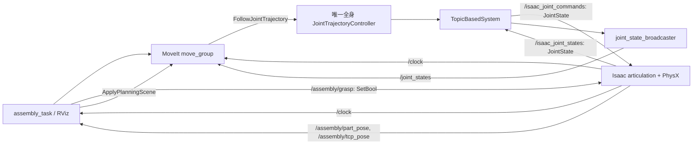

# JAKA Kargo 双臂装配联合仿真 MVP

先阅读 [现有工程分析](assembly_analysis.md)。本实现复用原 URDF、USD、KDL
和 `JointTrajectoryController`，在原 SRDF 补充双臂组合组；不启动 `jaka_kargo_driver` 或 `kargo_moveit_server`。
后者直接连接真实 SDK，不属于仿真规划节点。

## 架构与接口



所有 ROS 控制节点使用 `use_sim_time=true`。Isaac 持续发布实际位置、速度及仿真时钟。
关节命令按名称匹配，不依赖 USD DOF 数组顺序。21 个受控关节按配置顺序为
`arm_lj1…7`、`arm_rj1…7`、`body_j1…4`、`agv_x/y/yaw`。
ROS 旋转单位为 rad，直线轴为 m；启动时审计 USD 的关节类型、拓扑及 degree 限位换算。
`/assembly/ready` 在 21 个受控关节的实测零位误差小于 0.02、速度小于 0.03，
并连续稳定 0.5 秒仿真时间后才为 true；完成初始化后正常任务运动不会清除它。
任务同时要求新鲜的关节、零件和 TCP 消息。位置增益 20000、阻尼 1000 在 Play 前写入
USD session layer，旋转驱动按 degree 单位换算，保留原关节力矩上限，避免仅设置运行时
增益后在 articulation 重建时失效。启动日志将报告未收敛的误差。

装配入口先启动控制管理器，使用配置中的零位指令保持初始化；只有 `/assembly/ready=true`
且最新实测关节仍在稳定零位时，才加载并激活 `jaka_kargo_full_robot_controller` 和状态广播器。
等待超过 90 秒会终止启动，防止轨迹控制器在初始化尚未完成时把偏移姿态采纳为保持目标。
该轨迹控制器允许
单臂部分关节目标，未指定轴保持当前位置。双臂目标分别使用原单臂组求 IK，再由
SRDF 的 `jaka_kargo_dual_arms` 一起规划。该组仅组合原左右臂子组，共 14 轴；
底盘和躯干不进入规划轨迹，由唯一 JTC 保持；自碰撞及环境碰撞检测继续启用。
原 `jaka_kargo_full_robot` 保留，用于全机器人反馈和有效性检查。
不要在自动任务运行时从 RViz 同时执行轨迹。

## 构建

ROS 2 Humble、MoveIt 2、ros2_control、`topic_based_ros2_control`、Boost、cJSON
以及原仓库的 SDK 开发依赖需要已安装。Isaac 集成以本机 **4.5** API 为基准；
GUI 或 headless 运行均需要可用的 NVIDIA 驱动/GPU。Isaac 无需安装到 ROS 的 Python 环境。

```bash
cd /path/to/JAKA_KARGO/jaka_kargo_ros2
source /opt/ros/humble/setup.bash
colcon build --symlink-install --packages-up-to jaka_kargo_planner
source install/setup.bash
```

每个 ROS 终端都先 source 上述两个 setup 文件，并使用同一个空闲 ROS 域，例如：

```bash
export ROS_DOMAIN_ID=45
export RMW_IMPLEMENTATION=rmw_fastrtps_cpp
```

## 按阶段启动

终端 1：打开现有机器人 USD，配置关节状态/控制图，并创建装配物理场景。
启动器隔离 Isaac 与系统 ROS 动态库，保留 ROS_DOMAIN_ID 等 DDS 设置。

```bash
ros2 launch jaka_kargo_isaacsim run_kargo_isaacsim.launch.py \
  isaac_root:=$HOME/isaacsim assembly:=true
```

终端 2：启动仓库内定义的控制器、MoveIt、机器人 TF 和 RViz。
此入口不依赖系统中被修改过的 `moveit_configs_utils/launches.py`。

```bash
ros2 launch jaka_kargo_moveit_config assembly_sim.launch.py
# 无 RViz 时附加 use_rviz:=false；Isaac 无窗口时在终端 1 附加 headless:=true。
```

终端 3：先验证单臂，再验证双臂，最后运行装配。等待每条命令输出 SUCCESS 后再继续。

```bash
ros2 launch jaka_kargo_planner assembly_task.launch.py mode:=single
ros2 launch jaka_kargo_planner assembly_task.launch.py mode:=dual
ros2 launch jaka_kargo_planner assembly_task.launch.py mode:=assembly
```

`single` 将左肘第四轴从实测初始角度偏移 −0.35 rad（约 20°），停留 5 秒后返回。
在初始零位附近，左 TCP 平移约 15 cm，便于观察。`dual` 联合规划两臂第四轴同样偏移，
停留后返回。可用 `test_delta:=-0.25 test_hold_seconds:=10.0` 调整幅度和观察时间；
偏移绝对值限制在 0.15–0.5 rad，所有目标仍需通过关节限位和碰撞检查。
日志 `MOTION` 记录 Isaac 实测起点、终点和角度变化，`TEST` 记录反馈 FK 的 TCP 位移。
两者均实际调用 MoveIt 规划、碰撞检测及完整轨迹执行 action。

常规运动默认速度/加速度比例为 **0.3/0.3**；APPROACH 和 PLACE 使用共享配置中的
精细比例 **0.1/0.1**。可覆盖常规比例：

```bash
ros2 launch jaka_kargo_planner assembly_task.launch.py mode:=assembly velocity_scaling:=0.3 acceleration_scaling:=0.3
```

`test_hold_seconds` 只控制 single/dual 的观察停留，不影响 assembly 的速度。
位姿目标先用当前反馈作为碰撞感知 IK 的种子，将等价旋转角选到限位内最近的圈数，
再调用 MoveIt 联合规划，减少短距离动作中的冗余绕行。
物理步长保持 0.005 s，渲染步长为 0.02 s，每帧推进四个物理步；更新后需重启 Isaac。
日志同时报告轨迹仿真时长、执行墙钟/仿真时长及 `real_time_factor`。
该倍率低于 1 时墙钟执行更慢，本机本轮长动作约为 0.32–0.40，仍受 GPU/渲染负载影响。
详细改动、规划与执行的计时区别及前后实测见[提速记录](planning_performance.md)。

## 场景与简化抓取

唯一场景数据源是 `jaka_kargo_isaacsim/config/assembly_scene.json`，同时由 Isaac
和任务 launch 读取。坐标系为原模型的 `world`，长度 m、质量 kg。
工作台、装配基座和本地地面为固定碰撞几何；A 为质量 0.2 kg、边长 0.06 m
的动态立方体，显式设置箱体惯量、摩擦、碰撞偏置和零恢复系数。B 为基座顶面的绿色标记。
地面最高点为 -0.32 m，避开原底盘网格的最低点约 -0.3135 m。

原模型没有夹爪；此处是**虚拟工具的固定约束抓取演示**，不模拟手指闭合或抓持力。
TCP 为左第七轴连杆沿局部 Z 偏移 0.2 m 的既有坐标系。TCP 靠近零件顶面且机器人
静止后，服务在仿真线程中创建 `UsdPhysics.FixedJoint`，用当前相对变换定义两端锚点，
并设置 `excludeFromArticulation=true`。释放时解除该关节，让零件受重力落在基座上。
抓取、搬运、释放均不修改零件位置。所有 USD 修改位于 session layer，不保存源 USD。

任务同步更新 MoveIt 的世界/附着碰撞物体；只将 TCP 和末端法兰作为 touch links。
附着时 MoveIt 自动移除对应世界物体，不能在同一 diff 再发一次世界 REMOVE。
抓取及释放后回读场景，验证 `part_a` 只存在于附着/世界容器之一。
`/assembly/grasped` 是 transient-local Bool，报告 Isaac 固定约束 prim 的创建/解除状态。
抓取离台期间临时允许 A 与工作台接触，抬起后恢复检查；放置阶段允许 A 与基座接触。
机器人自碰撞继续使用原 SRDF 排除表，Isaac 同样设置对应的物理过滤对。
右臂在联合搬运时到达配置中的等待位姿；MVP 不包含双臂共同夹持或力装配。

## 状态、失败处理与日志

| 状态 | 动作与成功条件 |
|---|---|
| INIT | 检查独占控制源、真实仿真反馈、限位、起始碰撞；以当前已验证姿态作为 HOME |
| MOVE_TO_PREGRASP | 左 TCP 到零件顶面上方，规划/执行成功并检查 TCP 误差 |
| APPROACH | 运动到抓取位姿，要求实测 TCP 和 MoveIt FK 一致 |
| GRASP | 物理固定关节创建成功，MoveIt 世界物体转为附着物体 |
| LIFT | 抬起零件，要求实际零件高度增加至少 0.08 m |
| TRANSFER | 双臂分别求 IK，14 轴双臂组联合规划到搬运/等待位姿 |
| PLACE | 左臂将附着零件下降到基座上方 |
| RELEASE | 解除约束；等待 1 秒仿真时间，更新实际零件碰撞位姿并检查最终误差 |
| RETREAT | 左臂撤离目标区域 |
| HOME | 双臂规划回任务开始时的有效姿态 |
| SUCCESS / FAILED | 成功结束，或停止后续运动并输出错误 |

规划失败、IK 失败、action 执行失败、反馈失效、控制源冲突和位姿误差超限均终止任务。
执行有墙钟看门狗，避免仿真暂停后无限等待。失败时不自动释放仍被抓持的零件，
以免物理状态与规划场景进一步分离；重新运行前重启场景/控制器并检查日志。
只读控制器发现查询允许重试；抓取和场景修改超时后直接终止，不盲目重试。

日志包含每个状态进入/完成、规划时间、执行墙钟/仿真时间、实时倍率、轨迹点数、最大关节误差、
TCP 位置/姿态误差、规划碰撞检查结果，以及最终零件位置/姿态误差。
默认最终位置误差阈值 0.015 m、姿态误差阈值 0.15 rad，可在共享配置中修改。
ROS launch 默认记录日志；可另用 `ros2 bag record /clock /joint_states /isaac_joint_states
/assembly/part_pose /assembly/tcp_pose /assembly/grasped /display_planned_path /monitored_planning_scene` 记录数据。
统计成功率时每次重置物理场景，以 SUCCESS 次数除以总尝试次数；本版本没有长期统计数据库。

## 验证方法及当前证据

```bash
colcon test --packages-select jaka_kargo_isaacsim
colcon test-result --verbose
python3 src/jaka_kargo_isaacsim/test/run_usd_tests.py --isaac-root "$HOME/isaacsim"
# 仅软件回环：真实 MoveIt/JTC + 关节命令回显，无 Isaac、无动力学。
ROS_DOMAIN_ID=178 python3 src/jaka_kargo_isaacsim/test/run_control_loopback.py
# 在已启动的 Isaac + assembly_sim 所用 ROS 域中执行单臂实测（会运动并返回）：
python3 src/jaka_kargo_isaacsim/test/run_physical_motion.py --execute
# 双臂物理运动及返回验证：
python3 src/jaka_kargo_isaacsim/test/run_physical_motion.py --execute --mode dual --log-dir /tmp/kargo-physical-dual
# 软件回归：去程后注入躯干反馈偏移，验证 HOME 返回：
ROS_DOMAIN_ID=178 python3 src/jaka_kargo_isaacsim/test/run_control_loopback.py --body-drift 0.0014
```

前三个本地检查分别覆盖共享场景/控制器契约、USD 关节审计、固定关节生命周期和
抓取距离拒绝；USD 检查使用 Isaac 自带 USD 库，不启动 Kit 或 PhysX。
软件回环在隔离 ROS 域中验证单臂/双臂规划、轨迹 action、TopicBasedSystem 与状态返回，
并检查装配关键位姿的带碰撞检测 IK。它只能验证软件链路，不能证明机器人动力学或抓取效果。
物理观察器独立记录指令、Isaac 实测、ROS joint_states 和物理 TCP；要求每个被测试肘关节变化至少
0.28 rad、左 TCP 位移至少 0.10 m、返回误差小于 0.035 rad，同时检查保持轴未明显移动。
结果保存在 `/tmp/kargo-physical-motion/`。可加 `--capture-desktop` 记录前/停留/后截图
（需桌面环境及 Pillow）。旧测试仅转动第七轴 0.08 rad，TCP 不平移，已改为可见的肘部动作。

本次环境中三个修改包的标准 colcon 构建已通过；配置测试及 USD 静态测试已通过。
单臂与双臂软件回环已观察到 SUCCESS；六个关键位姿的碰撞感知 IK 检查通过。
初次 IK 检查发现较远的预抓取点不可达，已将 A 和基座 X 坐标移至 0.52 m 后复验。
初次沙箱检查无法访问 NVIDIA 驱动；随后经用户授权在沙箱外实际启动了 Isaac PhysX 和
RViz，并完成 `mode:=single`、`mode:=dual` 物理轨迹与返回测试（SUCCESS，最大关节目标误差约
0.004 rad）。双臂去程后躯干偏移 0.0014 rad 的软件回归也通过。
之后已实际完成一轮完整装配（GRASP、LIFT、TRANSFER、PLACE、RELEASE、RETREAT、HOME 全部通过），
固定约束创建/解除和世界/附着切换均验证；零件最终位置误差约 3.1 mm，总任务墙钟约 67.5 s。
这是一轮成功结果，不代表重复成功率；尚未验证真实夹爪、共同夹持、力控制或硬件。记录见
[物理验证记录](physical_validation_2026-10-15.md)。

## 常见问题

| 现象 | 检查方法 |
|---|---|
| 无 `/clock`、任务等待反馈 | Isaac 是否处于 Play；两个终端 ROS_DOMAIN_ID、FastDDS 设置是否一致；检查 `ros2 topic hz /clock` |
| 控制器加载超时 | 先查看 `assembly_controller_activation_gate` 日志和 `/assembly/ready`。初始化未通过时控制器不会激活；核对零位误差、速度和时钟。稳定后应仅有全身轨迹控制器和状态广播器 active |
| 找不到 TopicBasedSystem | 检查 `topic_based_ros2_control` 是否安装；本入口传入 `use_isaac_sim=true` |
| articulation root 或限位不匹配 | 不同 USD 不保证兼容；启动审计会给出具体关节/拓扑错误，不要只重命名 topic 绕过 |
| 测试成功但动作难观察 | 更新并构建 planner；当前 single 默认左肘 −0.35 rad，观察停留 5 秒。可设 `test_hold_seconds:=10.0`；旧第七轴测试不改变 TCP 位置。检查 `MOTION` 实测变化及 `/tmp/kargo-physical-motion/summary.json` |
| 无法抓取 | 检查 `/assembly/tcp_pose`、`/assembly/part_pose`，确认虚拟 TCP 靠近零件顶面且实际速度小于 0.05 |
| GRASP 报场景更新失败 | 旧版附着与世界 REMOVE 重复，已修复。失败可能已建立物理约束且部分更新 MoveIt；重置 Isaac 和控制栈后重试，不直接重跑。检查 `/assembly/grasped` 及 `SCENE part_a attached=true world=false verified` |
| 运行过慢 | 查看 `trajectory_sim_time` 和 `real_time_factor`，分别检查 IK 绕行、速度比例和渲染负载。当前常规比例 0.3、精细阶段 0.1；`test_hold_seconds` 不调节装配速度 |
| 双臂 HOME 规划 code=-2 | 原因曾为躯干偏移超出 ±0.001 的全身路径约束。更新构建后需重启 MoveIt/RViz 加载新增 SRDF 组；日志应为 `PLAN group=jaka_kargo_dual_arms`。当前环境已重启验证。原全身组仍保留 |
| 起始碰撞、IK 或规划失败 | 查看 `INITIAL_JOINT`、`INITIAL_LINK`、`WORKBENCH` 和碰撞 depth；名义零位时左第五连杆最低约 0.392 m，高于 0.300 m 桌面。若实测关节偏离零位，检查启动收敛日志。更新初始化代码后需重启 Isaac 和控制栈；不关闭碰撞检测，也不从穿透姿态自动规划逃逸 |
| JointState 提示轮子缺失 | 原 ros2_control 只配置 21 个受控轴，轮子不参与装配规划；需要轮子显示/运动时另补只读反馈接口 |
| Octomap 没有传感器插件 | MVP 使用显式几何碰撞场景，没有接入深度相机；此提示不影响显式碰撞体 |
| NVIDIA/Kit 初始化失败 | 先确认 `nvidia-smi` 和 Isaac 自带示例能运行；headless 也需要有效驱动 |
| shutdown 或暂停时卡住 | 保持 `/clock` 推进直到 ROS 控制栈退出；任务看门狗会请求停止，但不修复失效的驱动进程 |

接口依据：[MoveIt Humble MoveGroupInterface](https://moveit.picknik.ai/humble/doc/examples/move_group_interface/move_group_interface_tutorial.html)
和 [OpenUSD Joint 定义](https://openusd.org/release/api/class_usd_physics_joint.html)。
Isaac API 同时核对了本机 4.5 安装中的 `isaacsim.core.prims` 与 ROS 2 Bridge 实现。


## 文件清单

- 新增 `moveit_config/launch/assembly_sim.launch.py`、`config/assembly_*controllers.yaml`、`scripts/wait_for_assembly_ready.py`、`test/test_activation_gate.py`：独占仿真控制链路与激活前的反馈检查。
- 修改 `moveit_config/config/jaka_kargo.srdf`：增加由原左右臂组成的 14 轴双臂组。
- 新增 `planner/src/assembly_task.cpp`、`launch/assembly_task.launch.py`：SDK-free MoveGroup 任务与测试模式。
- 新增 `isaacsim/config/assembly_scene.json`、`scripts/assembly_scene.py`、`scripts/assembly_bridge.py`、`scripts/assembly_startup.py`：共享场景、物理抓取接口及启动稳定性检查。
- 修改 `isaacsim/scripts/isaacsim_moveit.py`、`launch/run_kargo_isaacsim.launch.py`：装配模式、session layer、时钟与实际 articulation root。
- 修改上述包的 `CMakeLists.txt`/`package.xml` 及 `moveit_config/package.xml`：安装、运行依赖及测试注册。
- 新增 `isaacsim/test/test_assembly_contract.py`、`test_usd_assembly.py`、`run_usd_tests.py`、`run_control_loopback.py`、`run_physical_motion.py`：配置、USD、ROS 软件回环及独立物理运动记录。
- 更新根 `README.md`；新增本文与 `docs/assembly_analysis.md`。

上述包简称分别指 `src/jaka_kargo_moveit_config`、`src/jaka_kargo_planner`、
`src/jaka_kargo_isaacsim`。SRDF 仅新增双臂组合组；没有修改原 URDF、SDK 驱动或用户已有的 USD 文件。


### 起始碰撞诊断记录

2026-10-15 的只读实测中，`arm_lj1` 为 0.9671 rad、`body_j2` 为 0.2874 rad，
控制器期望分别为 0.9644、0.2858 rad；说明启动后的保持目标已是偏移姿态。
用该实测关节状态计算的左第五连杆最低点约为 0.2989 m，低于 0.3000 m 桌面；
其 TCP FK 与 Isaac 实测位置相差不到 0.1 mm，关节名称、单位和 TF 对应关系正确。
进一步的物理接触报告定位到启动时 `arm_rj2_link/base_link` 有约 0.043 m 穿透：
底盘单一 convexHull 填平了 CAD 凹槽，接触力将躯干及左臂推偏，控制器又捕获并保持此姿态。
修正为底盘 convexDecomposition，并将机器人 contact offset 设为 0.002 m；保留该碰撞对
和全部环境碰撞检查。控制器激活前的反馈门控防止初始化未稳定时接管。
修正后已完成真实 Isaac 单臂运动和返回验证。更新后需重启 Isaac 和 ROS 控制栈。

软件回环的门控、单/双臂轨迹和六个 IK 检查均通过；一次测试清理期间，本机已安装的
MoveIt 2.5.10 在析构 `TrajectoryExecutionManager` 时出现段错误。它发生在功能检查结束
后的 SIGINT 退出阶段，需单独排查；不能把功能检查通过理解为已验证整个进程退出流程。


需要排查物理接触或驱动目标时，可在启动 Isaac 前设置
`export KARGO_PHYSICS_DIAGNOSTICS=1`，日志中的 `ASSEMBLY_PHYSICS` 会报告实测关节值、
物理驱动目标、增益及接触对/穿透深度。此开关默认关闭，不改变物体位置或碰撞过滤规则。
